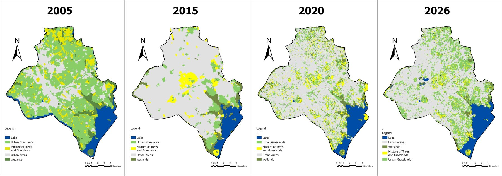
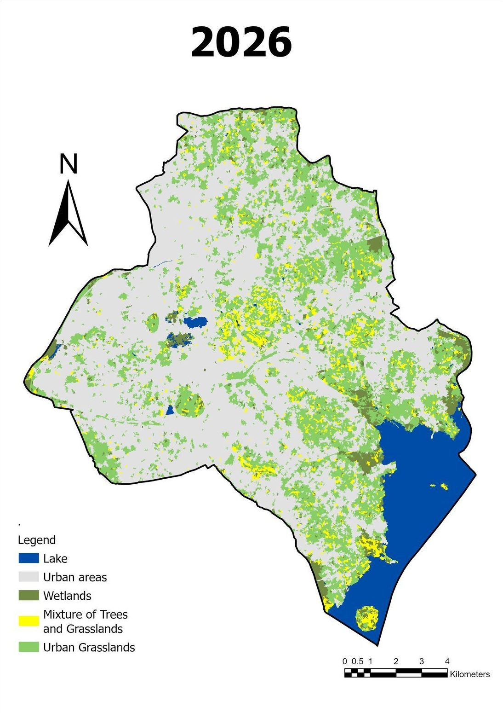
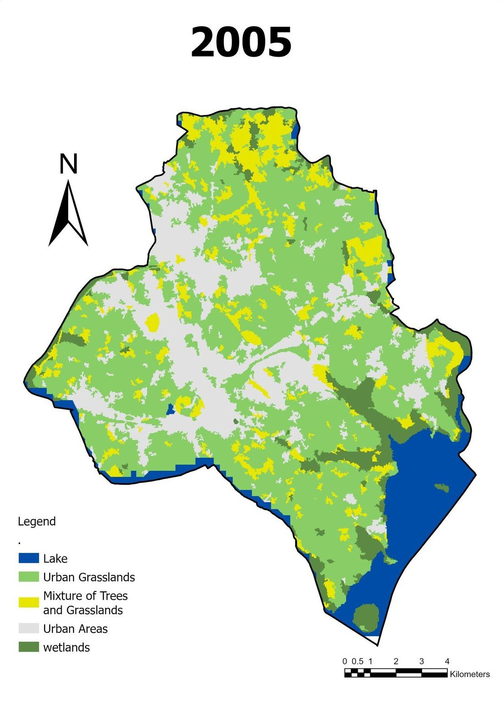
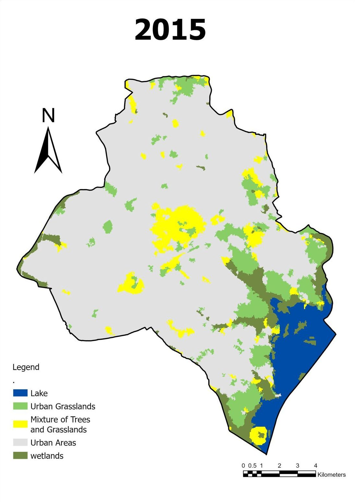
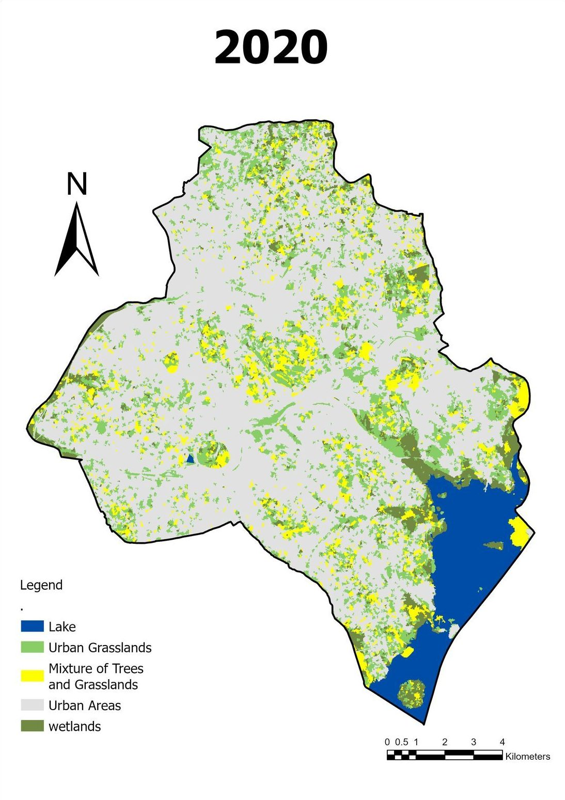

# Mirembe Priscillah

**GIS & Remote Sensing Specialist · Hydrogeologist · Geospatial Developer**
Kampala, Uganda

[**View the portfolio website**](https://mirembe1.github.io/work-portfolio/) &nbsp;|&nbsp; [Email](mailto:mipriscillah@gmail.com) &nbsp;|&nbsp; [LinkedIn](https://www.linkedin.com/in/mirembe-priscillah-a70050258) &nbsp;|&nbsp; +256 702 913 028

Land cover change in Kampala District, 2005–2026, from my object-based Landsat and Sentinel-2 classification.

---

I turn field measurements, satellite imagery and project registers into maps and tools that engineers, planners and communities can act on, from groundwater models and borehole siting to land-cover change across Kampala.

## Projects

| | Project | What I did | Tools |
|---|---|---|---|
|  | [**Land cover change in Kampala, 2005–2026**](projects/kampala-lulc/) | Classified four epochs of imagery (mean-shift segmentation + SVM) and assessed accuracy (OA 72–88 %, kappa 0.63–0.83) | ArcGIS Pro, Landsat 8, Sentinel-2 |
|  | [**HYDRO_SYNC**](https://github.com/Mirembe1/tethysapp-Hydro_sync) | Open-source web platform for digital hydrogeological field data: forms, GPS capture, central database, live map | Python, Tethys Platform |
|  | [**Baseline maps for a small hydropower site**](#baseline-maps-for-a-small-hydropower-site--kiryandongo-district) | Lithology, land use, elevation, rainfall and soil maps for Kiryandongo District | QGIS, DEM analysis |
|  | [**Groundwater model and drawdown mapping**](#groundwater-model-and-drawdown-mapping--isaac-plains--isaac-downs-queensland) | Model mesh, boundary conditions and predicted drawdown maps per hydrostratigraphic unit | MODFLOW, QGIS |
|  | [**Infrastructure and environmental field mapping**](#infrastructure-and-environmental-field-mapping--uganda) | Expressway support facilities, PM2.5 air quality and field survey locations from GPS data | QGIS, GPS, interpolation |
|  | [**Headrace design tool**](#headrace-design-tool-for-small-hydropower) | Excel tool and dashboard for headrace sizing, head losses, power and annual energy | Excel |

---

### Land cover change in Kampala, 2005–2026

Object-based classification of Landsat 8 (2015) and Sentinel-2 (2020, 2026) imagery, plus a 2005 scene, into five classes: lake, urban areas, wetlands, tree–grass mixture and urban grassland. Built-up land spreads across most of the district, while wetland corridors draining to Murchison Bay narrow.

   

➡️ [Method, accuracy tables and full-resolution maps](projects/kampala-lulc/)

### HYDRO_SYNC: digital field data for hydrogeology

Built during the Tethys Geoscience Foundation Mentorship Program (2026). Field teams record VES and resistivity surveys and site data on digital forms with GPS capture; records sync to a central groundwater database and appear on a live map for analysis and reporting.

➡️ [Source code](https://github.com/Mirembe1/tethysapp-Hydro_sync)

### Baseline maps for a small hydropower site — Kiryandongo District

Paired baseline maps on a common layout: (a) lithology and (b) map-sheet index; (a) land use and (b) elevation; (a) mean annual rainfall and (b) soil types.

  

### Groundwater model and drawdown mapping — Isaac Plains & Isaac Downs, Queensland

Map figures for a multi-layer groundwater model around open-cut mining: model mesh, boundary conditions and maximum predicted cumulative drawdown in the weathered Permian, Rewan Formation and Leichhardt Seam.

   

### Infrastructure and environmental field mapping — Uganda

Maps built from GPS field coordinates: stone quarries, dumpsites and borrow pits supporting the Busega–Mpigi Expressway; an interpolated PM2.5 air-quality surface for Koome Island, Mukono District; and field data collection points across eastern Uganda.

 

### Headrace design tool for small hydropower

An Excel tool that sizes a headrace pipe or channel and reports friction and minor losses, net head, power and annual energy at different turbine efficiencies, with a dashboard and a built-in user guide.

 

---

## Skills

| Area | Tools and methods |
|---|---|
| **GIS & cartography** | QGIS (advanced), ArcGIS Pro, spatial analysis, data validation, map series and print layouts, Power BI |
| **Remote sensing** | Landsat and Sentinel-2 processing, object-based classification (segmentation + SVM), accuracy assessment, Google Earth Engine |
| **Hydrogeology** | Borehole siting, hydrogeological mapping, groundwater modelling (MODFLOW), pumping tests (Aquitest), water-quality assessment |
| **Data & development** | Python (Pandas, GeoPandas), SQL, GeoJSON, Excel (advanced), Tethys Platform, Git/GitHub |

## Experience

- **Geoscience Developer (mentee)**, Tethys Geoscience Foundation Mentorship Program — Jan–Jun 2026
- **Freelance GIS Specialist**, Nexus — Jan–May 2026
- **Research Assistant, GIS & Data Analysis**, Kampala Population Equivalent Project (Makerere University & Eawag) — Mar–Jun 2025
- **Junior Hydrogeologist & Administrator**, Aquatech Enterprises (U) Ltd — Jun 2023–Dec 2024

## Education

- MSc Geology, Makerere University (in progress)
- BSc Physical Sciences (Geology & Physics), Makerere University, 2023

---

**Get in touch:** [mipriscillah@gmail.com](mailto:mipriscillah@gmail.com) &nbsp;|&nbsp; [LinkedIn](https://www.linkedin.com/in/mirembe-priscillah-a70050258) &nbsp;|&nbsp; [Portfolio website](https://mirembe1.github.io/work-portfolio/)

