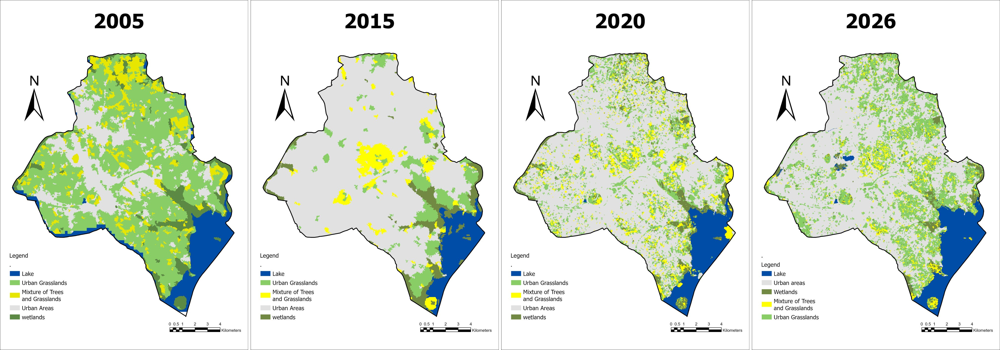

# Land Use / Land Cover Change — Kampala District (2005–2026)

Multi-temporal land use / land cover (LULC) mapping of Kampala District for four epochs: 2005, 2015, 2020 and 2026. The maps show how the city's built-up area has spread into grassland, tree and wetland cover around the Lake Victoria shoreline.

## Data

| Epoch | Imagery | Notes |
|---|---|---|
| 2005 | Multispectral image clipped to Kampala | Projected to WGS 84 / UTM |
| 2015 | Landsat 8 OLI/TIRS Collection 2 Level-2 surface reflectance, path 171 / row 60, 27 Feb 2015 | 30 m |
| 2020 | Sentinel-2A MSI Level-2A, tile T36NVF, 9 Feb 2020 | 10–20 m |
| 2026 | Sentinel-2A MSI Level-2A, tile T36NVF, 28 Aug 2026 | 10–20 m |

## Method

Object-based image classification in **ArcGIS Pro**:

1. Pre-processing: band stacking and clipping of each scene to the Kampala District boundary.
2. Segmentation: **mean-shift segmentation** grouped pixels into spectrally similar objects.
3. Training: training samples digitised for each class and epoch.
4. Classification: **Support Vector Machine** classifier (RBF kernel) trained on the segment mean and standard deviation of the image bands.
5. Accuracy assessment: confusion matrices from independent reference points, reporting overall accuracy and Cohen's kappa.
6. Cartography: map layouts with a consistent legend, scale bar and north arrow for all four epochs.

### Classes

| Class | Description |
|---|---|
| Lake | Open water of Lake Victoria (Murchison Bay) and inland water bodies |
| Urban areas | Built-up land: buildings, paved surfaces, roads |
| Wetlands | Papyrus and seasonally flooded wetland vegetation |
| Mixture of trees and grasslands | Tree cover mixed with grass and shrubs |
| Urban grasslands | Open grass, gardens and sparsely vegetated land within the urban fabric |

## Accuracy assessment

| Year | Reference points | Overall accuracy | Kappa |
|---|---|---|---|
| 2005 | 36 | 72.2 % | 0.63 |
| 2015 | 41 | 87.8 % | 0.83 |
| 2020 | 38 | 81.6 % | 0.74 |
| 2026 | 41 | 82.9 % | 0.76 |

Source table: [`data/accuracy_assessment.csv`](data/accuracy_assessment.csv)

## Key observations

- **2005:** grassland and tree–grass mosaics still covered most of the district, with built-up land concentrated in the centre.
- **2015–2026:** urban areas dominate the district. Remaining green space persists mainly as fragmented urban grassland, tree patches and the wetland corridors draining to Murchison Bay.
- **Wetland corridors** draining towards Murchison Bay narrow progressively across the four epochs, which matters for urban flooding and water quality.

## Limitations

- The epochs come from different sensors (Landsat 30 m vs Sentinel-2 10 m). Some of the apparent change between 2015 and 2020/2026 reflects resolution: finer pixels separate small green spaces inside the city that 30 m pixels merge into "urban".
- The reference samples are small (36–41 points per epoch), so class-level accuracies carry wide uncertainty. Mixed classes (urban grasslands vs tree–grass mixture) are the main source of confusion.
- The maps are intended for planning and education, not for legal or cadastral use.

## Maps

High-resolution A4 map sheets: [`maps/`](maps/)

- [2005](maps/kampala_lulc_2005.jpg) · [2015](maps/kampala_lulc_2015.jpg) · [2020](maps/kampala_lulc_2020.jpg) · [2026](maps/kampala_lulc_2026.jpg)

## Tools

ArcGIS Pro (Image Classification Wizard, Segment Mean Shift, SVM classifier, Compute Confusion Matrix) · Landsat 8 · Sentinel-2

---
*Author: Mirembe Priscillah — GIS & Remote Sensing / Hydrogeology, Kampala, Uganda.*
